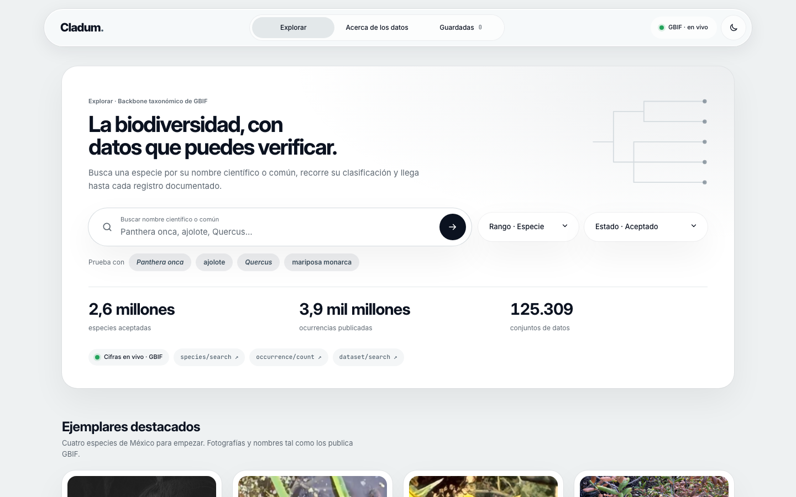
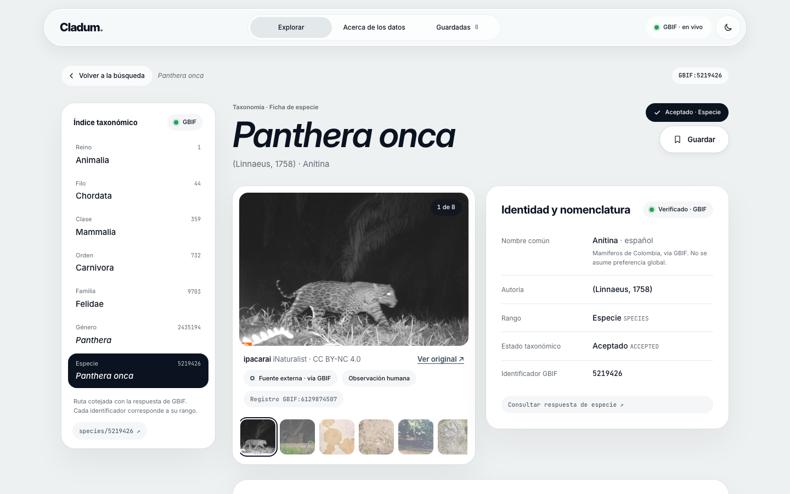
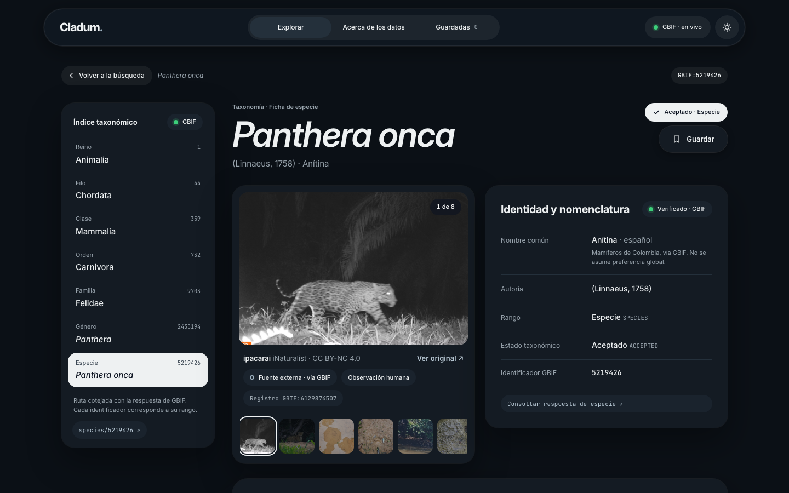

# Cladum

Explorador de biodiversidad con datos verificables de [GBIF](https://www.gbif.org).
Busca especies, recorre su clasificación de reino a especie y consulta sus ocurrencias documentadas, con la procedencia de cada dato siempre visible.

**[Ver demo en vivo →](https://jonnschenk.github.io/Cladum/)**




| Ficha de especie | Modo oscuro |
|---|---|
|  |  |

## Lo más destacado

- **Datos honestos:** cada valor se marca como *Verificado · GBIF*, *Fuente externa* o *Sin dato*, con un enlace a la consulta exacta de la API. Nunca se rellena con información inventada.
- **Red robusta:** cliente Axios con tiempo máximo, caché y errores tipados; reintento automático ante el límite de consultas (429); cancelación al salir de una vista y descarte de respuestas viejas por `requestId`.
- **Respaldo de fotografías:** si GBIF no tiene imágenes o fallan al cargar, se buscan en iNaturalist solo con coincidencia exacta de nombre y licencia abierta.
- **Accesibilidad WCAG 2.2 AA:** combobox ARIA navegable con teclado, foco visible y una región viva que anuncia los cambios de estado.
- **105 pruebas** con Jest y React Testing Library, sin llamadas reales a la red, y despliegue continuo que no publica si alguna falla.

## Funciones

- **Explorar:** búsqueda por nombre científico o común con sugerencias en vivo (navegable con teclado), filtros por rango y estado taxonómico, y "¿Quisiste decir…?" cuando no hay coincidencias. Si escribes un género («Quercus»), muestra sus especies.
- **Índice taxonómico:** la ruta Reino → Especie con el identificador GBIF de cada rango. Al hacer clic en un rango superior se listan las especies que contiene.
- **Ficha de especie:** identidad y nomenclatura, nombre común en español, galería de fotografías con autoría y licencia (con respaldo en iNaturalist, ver abajo), recuento de ocurrencias y aviso cuando las ubicaciones están generalizadas.
- **Ocurrencias:** registros con país, fecha, observador, incertidumbre e incidencias de calidad. Incluye filtro por país y por coordenadas, y detalle del registro seleccionado.
- **Guardadas:** colección personal en `localStorage`, con búsqueda y opción de deshacer.
- **Clave de procedencia:** cada dato se marca como *Verificado · GBIF*, *Fuente externa* o *Sin dato*. Nunca se inventa información.
- **Errores que explican qué pasó:** tiempo agotado, sin conexión, límite de consultas (con reintento automático), servicio caído o taxón inexistente, cada uno con su mensaje y la consulta exacta que falló.
- Modo claro y oscuro, diseño responsivo y accesibilidad WCAG 2.2 AA (foco visible, combobox ARIA, contraste y estados anunciados).

## Stack

- **React 19** con componentes funcionales y hooks
- **React Router 7** (`HashRouter`)
- **Redux Toolkit**: slices, `createAsyncThunk` y listener middleware
- **Axios**: cliente HTTP con tiempo máximo, caché y errores tipados
- **Sass/SCSS** con nomenclatura BEM (arquitectura 7-1 reducida)
- **Jest** + React Testing Library + axios-mock-adapter
- **Vite** para desarrollo y build
- APIs: GBIF v1 e iNaturalist v1 (sin clave; iNaturalist solo como respaldo de fotografías)

## Estructura

```
cladum/
├── index.html                 entrada de Vite (tema sin parpadeo y pantalla de arranque)
├── public/favicon.svg
├── docs/                      capturas de pantalla del README
└── src/
    ├── main.jsx               Provider de Redux + HashRouter
    ├── App.jsx                rutas
    ├── config.js              URLs de las APIs y constantes
    ├── app/store.js           store y persistencia (listener middleware)
    ├── features/              slices de Redux y lógica de cada dominio
    │   ├── ui/                tema, conexión, avisos y anuncios
    │   ├── favorites/         especies guardadas
    │   ├── search/            búsqueda, detección de género y relevancia
    │   ├── species/           ficha de especie
    │   ├── occurrences/       registros y filtros
    │   └── home/              cifras de la portada
    ├── services/              única capa que habla con las APIs (Axios)
    │   ├── http.js            cliente común: tiempo máximo, caché y errores tipados
    │   ├── gbif.js
    │   ├── inaturalist.js     respaldo de fotografías
    │   └── photos.js          elige la fuente: GBIF primero, iNaturalist si falla
    ├── hooks/                 custom hooks (useThunk, useSuggestions, usePhotoFallback…)
    ├── pages/                 una por ruta
    ├── components/
    │   ├── layout/            encabezado, pie y estructura común
    │   ├── ui/                piezas reutilizables (estados, enlaces, esqueletos…)
    │   ├── feedback/          avisos y región viva para lectores de pantalla
    │   ├── taxonomy/          índice taxonómico
    │   ├── search/  home/  species/  occurrences/
    ├── styles/                SCSS: abstracts, base, layout, components, views
    ├── utils/                 formato, URLs, almacenamiento y rutas
    └── test/                  utilidades de prueba (store + router, API simulada)
```

## Cómo correrlo

Requiere Node 20 o superior.

```bash
npm install
npm run dev            # http://localhost:5173
```

| Script | Qué hace |
|---|---|
| `npm run dev` | Servidor de desarrollo con recarga al guardar |
| `npm test` | Pruebas con Jest |
| `npm run test:watch` | Pruebas en modo observador |
| `npm run test:coverage` | Pruebas con reporte de cobertura |
| `npm run build` | Build de producción en `dist/` |
| `npm run preview` | Sirve el build para revisarlo antes de publicar |

## Arquitectura

- **Servicios (Axios):** `createApi()` crea un cliente por API con tiempo máximo, caché por URL y errores tipados (`timeout`, `rate-limit`, `offline`, `not-found`…). Las vistas nunca llaman a Axios directamente.
- **Estado (Redux Toolkit):** cada dominio tiene su slice. Las consultas son `createAsyncThunk` que reciben la señal de cancelación; al salir de una vista, su consulta se cancela. Cada respuesta lleva su `requestId`, así que una respuesta vieja nunca pisa a una nueva. Los errores se guardan como objetos simples (el store solo admite datos serializables).
- **Persistencia:** un listener middleware guarda las especies y el tema en `localStorage`, y la última ficha en `sessionStorage`. Si el navegador no deja guardar (modo privado), la app lo avisa en lugar de confirmar en falso.
- **Datos locales de un componente** (sugerencias del buscador, foto seleccionada) viven en hooks, no en Redux.

## Rutas

| Ruta | Página |
|---|---|
| `#/` | Explorar |
| `#/?q=Panthera%20onca` | Resultados |
| `#/?higher=9703&label=Felidae` | Especies dentro de un taxón |
| `#/especie/5219426` | Ficha |
| `#/especie/5219426/ocurrencias?country=BR` | Ocurrencias |
| `#/guardadas` | Guardadas |
| `#/datos` | Acerca de los datos |

Las rutas usan `#` (`HashRouter`) para funcionar en cualquier hosting estático sin configurar redirecciones.

## Pruebas

```bash
npm test
```

Ninguna prueba llama a la red: GBIF e iNaturalist se simulan con `axios-mock-adapter`.

- **Funciones:** formato de números, fechas y licencias; URLs seguras; relevancia de resultados.
- **Servicios:** caché, parámetros vacíos, traducción de cada error HTTP, cancelación, respaldo de fotos.
- **Slices:** detección de género, "¿Quisiste decir…?", respuestas viejas descartadas, "Cargar más", filtros, persistencia.
- **Custom hooks:** debounce, aviso de demora, cuenta regresiva, respaldo de fotos, sugerencias, reintento.
- **Componentes y páginas:** navegación con teclado del buscador, galería que retira fotos rotas, guardar y deshacer, filtros de ocurrencias, reintento automático ante un 429, rutas.

## Endpoints usados

**GBIF**

- `GET /species/suggest`: sugerencias del buscador
- `GET /species/search`: resultados, filtrados por el backbone taxonómico
- `GET /species/match`: "¿Quisiste decir…?" y detección de géneros
- `GET /species/{key}` y `/species/{key}/vernacularNames`: ficha y nombre común
- `GET /occurrence/search`: ocurrencias, fotografías (`media_type=StillImage`) y faceta de países
- `GET /occurrence/count` y `/dataset/search`: cifras de la portada

**iNaturalist**

- `GET /taxa?q={nombre}`: localiza el taxón por nombre científico
- `GET /taxa/{id}`: fotografías curadas del taxón (`taxon_photos`)

## Fotografías y respaldo

Las fotos se buscan en este orden, para que nunca quede un espacio vacío si hay alguna alternativa:

1. **GBIF**: imágenes de los registros de ocurrencia.
2. **iNaturalist**: si GBIF no tiene fotos, no responde, o todas sus imágenes fallan al cargar en el navegador.
3. **Sin dato**: solo si ninguna fuente tiene una imagen que cargue. El mensaje distingue entre "no se pudo consultar", "no se pudo cargar" y "sin fotografía documentada".

Si una foto o miniatura no carga, se retira de la galería en lugar de dejar un ícono. Para iNaturalist se aplican dos reglas:

- El taxón se busca por **nombre científico exacto**. Sin coincidencia exacta no se muestra nada, para no enseñar la foto de otra especie.
- Solo se usan fotos con **licencia abierta** (Creative Commons). Las marcadas como "todos los derechos reservados" se descartan.

Cada foto indica su fuente (*vía GBIF* o *vía iNaturalist*), su autoría, su licencia y un enlace al original.

## Despliegue

El sitio se publica en GitHub Pages con GitHub Actions ([`.github/workflows/deploy.yml`](.github/workflows/deploy.yml)): en cada push a `main` se instalan las dependencias, se corren las pruebas, se compila con Vite y se publica `dist/`. Si alguna prueba falla, no se publica.

Configuración única en GitHub: **Settings → Pages → Source: GitHub Actions**.

Como las rutas usan `#` y el build usa rutas relativas, `dist/` también funciona en Netlify, Vercel o Firebase Hosting sin configuración extra.

## Versión anterior

La primera versión, en JavaScript puro con módulos ES, está en la etiqueta [`v1-vanilla`](../../tree/v1-vanilla).

## Proyectos de referencia

- **GBIF.org**: la fuente de los datos, pensada para investigadores.
- **EncicloVida** (CONABIO): enciclopedia de especies de México.
- **OneZoom**: explorador visual del árbol de la vida.

Cladum se diferencia por hacer visible la procedencia de cada dato, enlazar la consulta exacta a la API y respetar las ubicaciones generalizadas de especies sensibles.

## Próximos pasos

- Mapa de ocurrencias con Leaflet, donde los registros generalizados se dibujen como áreas y no como puntos.
- Búsqueda en lenguaje natural con IA ("felinos nocturnos de México" → filtros de GBIF).
- Migración a TypeScript.

## Licencia

El código está bajo la licencia [MIT](LICENSE). Los datos y las fotografías no: conservan la licencia de su fuente.

---

Datos: GBIF.org. Fotografías de GBIF e iNaturalist, con la licencia y autoría indicadas en cada ficha.
